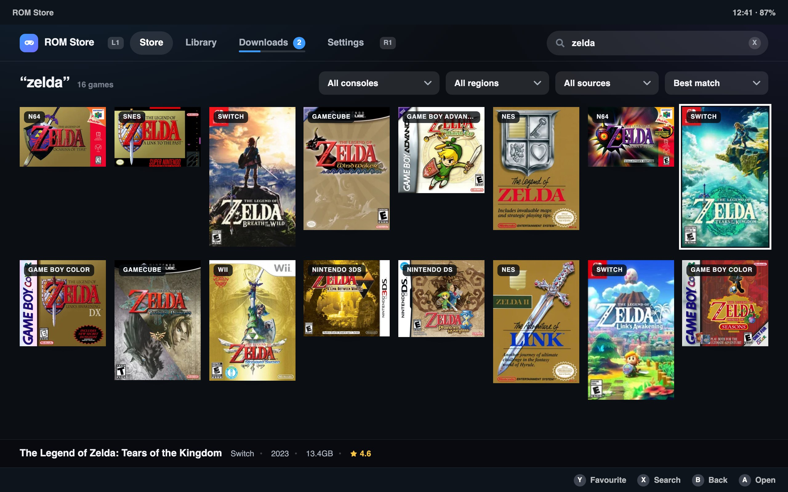
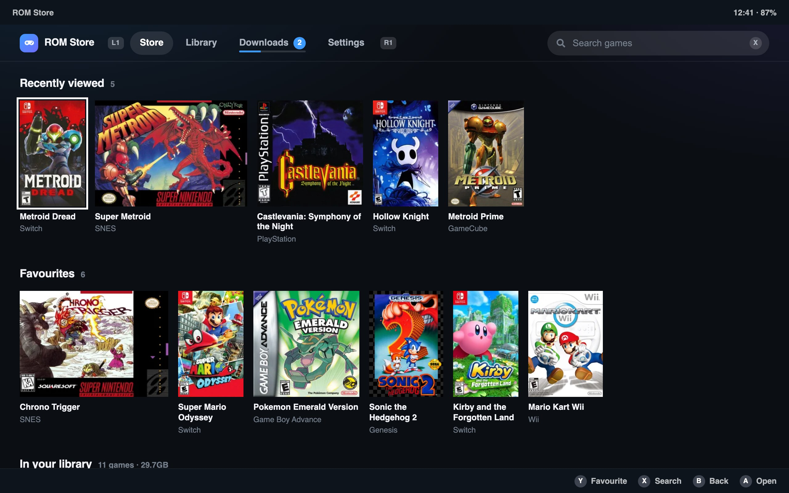
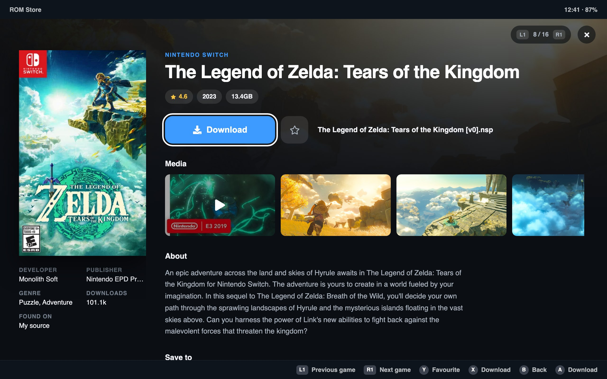
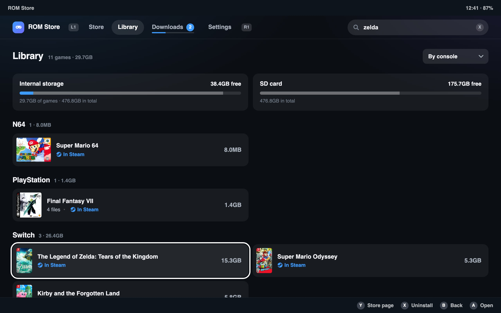
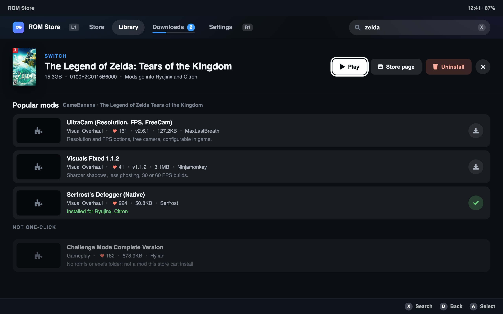
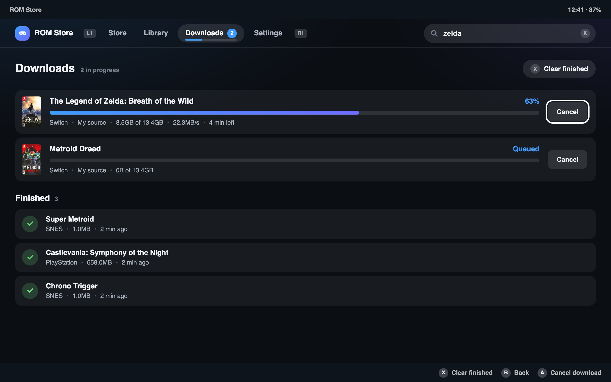
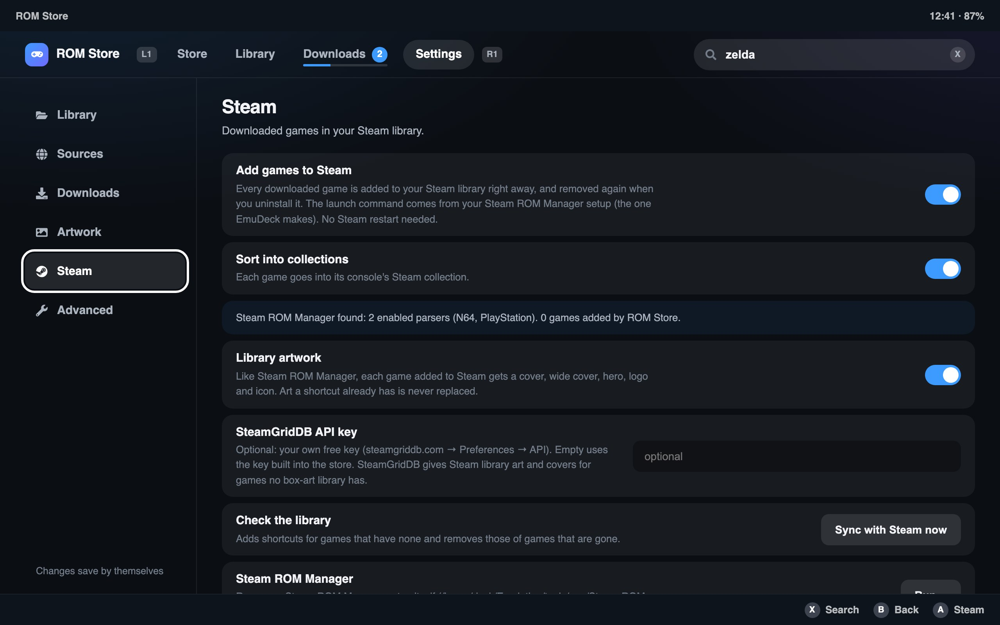

<div align="center">


# ROM Store

**A game store for the Steam Deck's emulators.**
Search the sites you set up, pick a game by its box art, and it lands in the
right EmuDeck folder and in your Steam library.

[](https://github.com/lauridskern/decky-rom-store/releases/latest)
[](https://github.com/lauridskern/decky-rom-store/releases)
[](https://github.com/SteamDeckHomebrew/decky-loader)
[](LICENSE)



</div>

## Install

In Game Mode open Decky Loader, then **Settings → Plugins → Install from URL**
and paste:

```
https://github.com/lauridskern/decky-rom-store/releases/latest/download/ROM-Store.zip
```

ROM Store then appears in the Quick Access menu (`…` button). Before the first
search, [add your sources](#adding-sources). It needs
[Decky Loader](https://github.com/SteamDeckHomebrew/decky-loader) and works best with
[EmuDeck](https://www.emudeck.com) (or EmuDecky) installed; any folder will do
for the games. Nothing else to install: the backend is plain Python.

<details>
<summary>Install by hand over SSH, or a specific version</summary>

A specific version: replace `latest/download` with `download/vX.Y.Z` in the URL.

By hand, copy the zip to the Deck and extract it into the plugins folder
(it contains one `rom-store-decky/` folder):

```bash
scp ROM-Store.zip deck@<deck-ip>:/home/deck/
```

```bash
sudo bash -c 'cd /home/deck/homebrew/plugins && rm -rf rom-store-decky && unzip -o /home/deck/ROM-Store.zip && chown -R root:root rom-store-decky'
```

Then restart Decky: `sudo systemctl restart plugin_loader.service`.

</details>

## A tour

<table>
  <tr>
    <td width="50%" valign="top">
      <br />
      <b>Home.</b> What you looked at last, your favourites, what is already
      on the Deck, and every console you can browse.
    </td>
    <td width="50%" valign="top">
      <br />
      <b>Game page.</b> Box art, rating, screenshots and trailer, the
      description, every version that was found, and where it will be saved.
    </td>
  </tr>
  <tr>
    <td width="50%" valign="top">
      <br />
      <b>Library.</b> The games in your ROM folders under their real names,
      how full each drive is. Play a game from its page, or uninstall it.
    </td>
    <td width="50%" valign="top">
      <br />
      <b>Mods.</b> The most popular GameBanana mods for Switch, GameCube and
      Wii games, installed into your emulators in one go.
    </td>
  </tr>
  <tr>
    <td width="50%" valign="top">
      <br />
      <b>Downloads.</b> Progress, speed and time left; downloads carry on
      after a restart.
    </td>
    <td width="50%" valign="top">
      <br />
      <b>Settings.</b> Your sources, where games go, artwork and the Steam
      library. Changes save by themselves.
    </td>
  </tr>
</table>

## What it does

- **One search, every site.** Every site you set up is asked at once. The same
  game from several sites becomes one cover, with every region and revision
  kept as a version you can pick.
- **Real box art.** Front scans from
  [libretro-thumbnails](https://github.com/libretro-thumbnails/libretro-thumbnails)
  for about 60 consoles, case covers from [GameTDB](https://www.gametdb.com)
  for Switch, Wii, Wii U, DS, 3DS and PS3, then the site's own cover,
  [SteamGridDB](https://www.steamgriddb.com) and [IGDB](https://www.igdb.com).
  Every cover keeps its box's real shape: square Game Boy boxes, wide SNES
  ones, tall Switch cases. Nothing is cropped.
- **Saved where your emulators look.** Downloads go to the console's folder in
  your EmuDeck/EmuDecky library (`~/EmuDecky/roms/<console>`,
  `~/Emulation/roms/<console>`, or the SD card).
  Archives an emulator cannot open (a PSP `.zip`, a GameCube `.7z`) are
  unpacked for you.
- **In Steam right away.** A downloaded game is added to your Steam library
  with the launch command from your Steam ROM Manager setup and artwork from
  SteamGridDB, without restarting Steam. Uninstalling removes it again.
- **Fastest file first.** The store measures how fast each site delivers and
  puts the file that will finish first on top.
- **Mods in one click.** For Switch (Ryujinx, yuzu, Citron, Eden, Sudachi,
  suyu) and GameCube/Wii (Dolphin): FPS and resolution mods, texture packs,
  gameplay mods, installed into every emulator found and removed exactly.
- **Made for the pad.** Every control is reachable with the d-pad, Steam's
  on-screen keyboard opens for search, and **B** always goes back one step.

## Adding sources

ROM Store comes without any sites to search. It knows how to read a fixed set of
sites, listed by name in *Settings → Sources*, but not where they are: look up
the address of each site you want to use and enter it under its name. A site
without an address is left out, and the home screen points you to Settings
until at least one is set up.

Every source can be switched off or its address changed at any time. One that
keeps failing is rested for a while instead of slowing every search down.
BIOS and firmware files are never offered, and if a site starts requiring a
login or a captcha, its reader is removed rather than worked around.

## Controls

| Where | Buttons |
|---|---|
| Anywhere | **L1 / R1** switch tabs · **X** search · **B** back one step |
| Home | d-pad through shelves and consoles · **A** open · **Y** favourite |
| Results | **A** game page · **Y** favourite · **L2 / R2** previous / next page |
| Game page | **A / X** download · **Y** favourite · **L1 / R1** previous / next game |
| Library | **A** game page: Play, mods · **X** uninstall (asks first) · **Y** store page |
| Downloads | **A** cancel, or open a finished game · **X** clear finished |
| Settings | up / down picks a section, right goes into it · **A** flips a switch |

Steam's button bar always shows what the buttons do where you are.

## Where things go

| | |
|---|---|
| Games | `<ROM folder>/<console>/`, the folder found automatically (`~/EmuDecky/roms`, `~/Emulation/roms`, the SD card) or set in *Settings → Library*. Existing files are never overwritten. |
| Covers and cache | `~/homebrew/data/rom-store-decky/` (covers capped at 250 MB; search results kept 72 hours) |
| Settings | `~/homebrew/settings/rom-store-decky/` |
| Log | `~/homebrew/logs/rom-store-decky/` |

The store never writes outside the ROM folder you chose, never deletes
anything outside it, and only removes Steam shortcuts it made itself.

## Troubleshooting

<details>
<summary>A source shows as unavailable</summary>

Sites go down and change their pages. *Settings → Sources* shows when each one
last answered and why it failed; after three failures in a row a source is
skipped for 15 minutes. If a site moved, enter its new address there.

</details>

<details>
<summary>A game is not added to Steam</summary>

The launch command comes from Steam ROM Manager's parsers (the setup EmuDeck
creates). *Settings → Steam → Sync with Steam now* adds what is missing and
lists the consoles that have no parser yet. A game still in an archive its
emulator cannot open shows *Needs unpacking* in the Library; its page has an
**Unpack** button.

</details>

<details>
<summary>Covers are missing</summary>

Box art comes through the image proxy [wsrv.nl](https://wsrv.nl) by default
(*Settings → Artwork*). A game without art anywhere shows its title instead.
IGDB fills in more covers over time as games are looked up.

</details>

<details>
<summary>The plugin does not show up after installing</summary>

Decky takes the plugin's name from the end of the URL, so the file must be
called `ROM-Store.zip`. Use the URL above unchanged and restart Decky Loader.

</details>

## Development

```bash
npm install
npm run build            # src/ -> dist/index.js
npm run typecheck
python3 -m unittest discover -s tests     # offline backend tests
python3 tools/selftest.py "mario"         # live check against the sites (temporary folder)
```

`tools/preview` renders the real UI in a browser with the Steam parts mocked,
so layout, gamepad focus and performance can be checked without a Deck:

```bash
cd tools/preview && npm install && npx playwright install chromium
npm run dev              # http://localhost:5174, in a 1280×800 Deck frame
npm run shots            # walks every screen with the pad and checks focus
npm run readme           # retakes the screenshots in this README
```

[`AGENTS.md`](AGENTS.md) documents the architecture, the tests, the release
steps and the rules that keep the store fast on the Deck.

## Legal

ROM Store is a client. This repository and its releases contain no games,
BIOS files, keys or other copyrighted game content. The plugin searches sites
that you choose and downloads a file only when you press Download, straight
from that site to your own Deck. What you download, and whether you may, is up
to you and the laws where you live.

MIT licensed. Box art from libretro-thumbnails, GameTDB and SteamGridDB;
metadata from IGDB; mods from GameBanana. Not affiliated with Valve,
Nintendo, Sony, Sega or any site the store can read.
