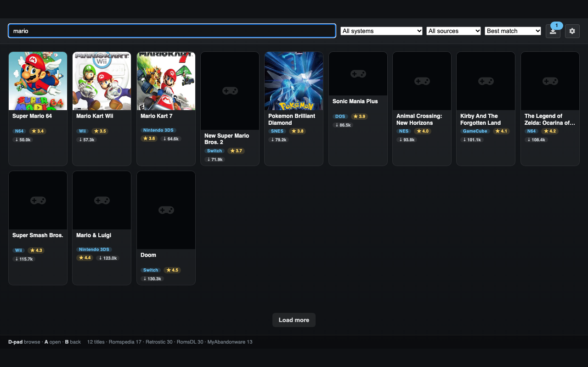

# ROM Store — Decky plugin

A game-store style front end for browsing and downloading ROMs on the Steam Deck.
It searches **Romspedia**, **Retrostic**, **RomsDL**, **DumbRoms** and
**MyAbandonware** at the same time, merges the results, removes duplicates, and
drops the file you pick straight into the matching **EmuDecky** ROM folder
(`~/EmuDecky/roms/<system>/`).



---

## What it does

| | |
|---|---|
| **Search** | One search box queries every enabled source in parallel and merges the hits. |
| **Browse** | The console dropdown lists every console with live title counts (including Switch) and switching to one browses that catalogue. Counts are scraped once and cached on the Deck for a day. Browsing a console walks the catalogue pages, so Switch shows the whole library (~90 titles) instead of one page. |
| **Gamepad** | Cards are Steam-focusable — the A button opens a game, the shoulder buttons page through results. |
| **Gallery** | Every game opens with a shelf of artwork that scrolls horizontally: the game's own screenshots (MyAbandonware has full galleries of up to 12 shots), the artwork from the site the game came from, and a trailer. Click any item for a full screen lightbox, where the trailer plays. Artwork comes from the ROM sites themselves, not from Steam, so it works for every console. |
| **Artwork** | Cover art is fetched by the backend, cached on the Deck and served locally, so nothing is re-downloaded and the Steam client never has to reach out to a third party. Every card uses the same poster frame with a blurred backdrop, so mixed artwork from different sites still looks uniform. Optionally, add free IGDB credentials in the settings to replace missing artwork with clean, high quality poster art. |
| **De-duplicate** | Titles are normalised (region tags, serial noise and punctuation are stripped) so the same game from two sites becomes one card with a `2×` badge. |
| **Region variants** | Every source entry is kept as a variant, so the USA / Europe / Japan builds of a title can be picked individually. |
| **One click download** | Press *Download*, the file is fetched in the background and written to the right system folder. |
| **EmuDecky aware** | The ROM root is auto-detected (`~/EmuDecky/roms`, `~/Emulation/roms`, SD cards, …) and the system folder is matched against the folders that actually exist on your Deck. |
| **Progress** | Live progress, speed, cancel button and *Open folder* for finished downloads. |

## User interface

The plugin is built on `@decky/ui` and `@decky/api` — the maintained
successors to the older `decky-frontend-lib` package that the current official
Decky plugin template uses. That means the UI is built from the same React
components the Steam client itself uses, so the console picker, the dropdowns
and the buttons behave exactly like the rest of the Deck interface (and are
gamepad navigable).

## Requirements

* SteamOS with [Decky Loader](https://github.com/SteamDeckHomebrew/decky-loader) (v3.1 or newer, `api_version: 1`).
* EmuDecky (or EmuDeck) installed, or any folder you want the games to land in.
* Network access to the ROM sites.

The plugin ships **no Python dependencies** — the backend only uses the standard
library, so there is nothing to compile and nothing to install on the Deck.

## Installation

### Install from the Deck (easiest)

Decky Loader → **Settings → Plugins → Install from URL**, then paste:

```
https://github.com/lauridskern/decky-rom-store/releases/download/v1.0.4/ROM-Store.zip
```

> Decky derives the plugin name from the **file name at the end of the URL** and
> expects `plugin.json`'s `name` to match it exactly, so the asset has to be
> called `ROM-Store.zip`.

Decky handles the root-owned `~/homebrew/plugins` folder for you. Restart Decky
Loader afterwards and the plugin appears in the plugin list.

### Install manually over SSH

```bash
# copy the package over first
scp ROM-Store.zip deck@<deck-ip>:/home/deck/

# then on the Deck (the plugins folder is root owned, hence sudo).
# The zip contains a rom-store-decky/ folder - extract it into the plugins
# folder, not into a folder of its own.
sudo bash -c 'cd /home/deck/homebrew/plugins && \
  rm -rf rom-store-decky && \
  unzip -o /home/deck/ROM-Store.zip && \
  chown -R root:root /home/deck/homebrew/plugins/rom-store-decky'
```

Use the explicit `/home/deck/...` paths: inside `sudo bash -c` a bare `~`
expands to `/root` instead.

### Building a release

Every `v*` tag builds the package with GitHub Actions and attaches it to the
release:

```bash
git tag -a v1.0.5 -m "v1.0.5" && git push origin v1.0.5
```

The asset is always named `ROM-Store.zip` and contains a `rom-store-decky/`
folder - Decky needs both to install it.

```bash
python3 tools/verify_package.py ROM-Store.zip   # checks it against Decky's own install logic
```

### Development

```bash
npm install
npm run build          # bundles src/ into dist/index.js
npm run typecheck      # tsc --noEmit
```

Useful extras:

```bash
python3 tools/selftest.py "mario"   # exercises the backend against the live sites
```

`tools/selftest.py` searches, resolves the download links and downloads one game
into a temporary folder, so you can verify the scrapers without touching your
real ROM library.

## Sources

| Source | Notes |
|---|---|
| **Switch ROMs** | `https://nintendo-switch-roms.com` — a Switch specific catalogue with hundreds of NSP/XCI titles. The game pages link straight to the file (no captcha, no countdown), so the downloads are direct. The base URL is a setting, so a mirror of the same site works too. |
| **Romspedia** | `https://www.romspedia.com` — server rendered search, region specific builds, direct file links on `downloads.romspedia.com`. The only source with a **Nintendo Switch** section. |
| **Retrostic** | `https://www.retrostic.com` — large classic catalogue, 46 consoles, direct zip downloads. |
| **RomsDL** | `https://romsdl.com` — the same engine as Retrostic with a different catalogue; good for extra region builds. |
| **DumbRoms** | The base URL and search URL are **settings**, because the domain has moved around. Point *Settings → Sources → DumbRoms* at the address you want to use. The parser is heuristic (it finds repeated link patterns), so it copes with most simple ROM indexes. |
| **MyAbandonware** | `https://www.myabandonware.com` — backed by a TypeSense index. The plugin reads the short-lived scoped search key out of the search page and queries the index directly. Older PC and console titles. |

Each source can be switched off individually if it is unreachable; failures are
reported per source in the status bar instead of breaking the whole search.

> The `romspedia.net` domain currently answers with a parked/redirect page — the
> working address is `romspedia.com`, which is what the plugin uses by default.

### About Nintendo Switch

Switch **is** fully supported: Switch titles are recognised, the browse panel
lists them and downloads land in `~/EmuDecky/roms/switch/`.

What the catalogues actually contain is the limiting factor, not the plugin:

* **Romspedia** has a Switch section with **9 titles** (Pokémon Brilliant
  Diamond/Shining Pearl, Animal Crossing: New Horizons, Sonic Mania Plus,
  Kirby and the Forgotten Land, Mario Strikers Battle League, Fire Emblem
  Warriors: Three Hopes, Castle Crashers Remastered, The Jackbox Party Pack 6).
  Searches for *Metroid Dread*, *Splatoon*, *Tears of the Kingdom* or
  *Mario Kart 8* return **no Switch results** — those titles simply are not in
  the index.
* **Retrostic / RomsDL / MyAbandonware** carry no Switch catalogue at all
  (MyAbandonware's platform list has 144 platforms, Switch is not one of them).

So for a full Switch library, point the **DumbRoms** adapter at a Switch-heavy
site — the generic adapter already recognises `.xci`, `.nsp` and `.nsz` files
and maps the console to the `switch` folder.

## Where files land

The plugin resolves the ROM root automatically:

1. the path you set in *Settings → ROM library* (if it exists),
2. `~/EmuDecky/roms`,
3. `~/Emulation/roms`,
4. `~/roms`,
5. `*/EmuDecky/roms` and `*/Emulation/roms` on mounted SD cards.

Inside that root the console folder is matched against the folders that really
exist (`n64`, `snes`, `switch`, `ps2`, `dos`, …) and created if it is missing.
The destination path is always shown before a download starts.

Existing files are never overwritten silently — the new file is written as
`Name (2).zip` instead.

## Settings

* **EmuDecky ROM folder** — override the detected root.
* **Sources** — enable/disable each site, and repoint the DumbRoms adapter.
* **IGDB client ID / secret** — optional. Create a free application at
  twitch.tv/developers and the store fills in missing artwork with clean
  poster art from the IGDB database.

* **Extract .zip archives** — unzip the download into the system folder.
* **Keep the archive too** — keep the zip next to the extracted files.
* **Results per source** / **Parallel downloads**.

## Troubleshooting

**"certificate verify failed" / every source shows as unavailable**

SteamOS ships an outdated CA bundle, so Python cannot verify modern
certificates. The plugin ships its own up to date CA store
(`backend/cacert.pem`) and uses it for every request, and falls back to a
relaxed context if even that fails. The trust store in use is logged on
startup:

```bash
grep "TLS trust store" ~/homebrew/logs/rom-store/rom-store.log
```

**The store is cut off by the Steam header bar**

The plugin measures the Steam chrome at runtime (it hit tests the DOM to find
where its own content becomes visible) and pads itself accordingly, so it works
in both Game Mode and Desktop Mode.

**The console list says "unavailable"**

The console list is scraped in the background and cached in
`~/homebrew/data/rom-store-decky/system_counts.json`. If it is empty the
backend could not reach Romspedia - check the status line in the plugin menu.

**The UI is unstyled**

The stylesheet is rendered inside the plugin's own React tree, so it cannot
be dropped by the Steam client re-rendering its `<head>`. If the plugin was
installed from an older release, update it and restart Decky Loader.

**A source is unreachable**

Each source reports its own status in the status bar (click the warning chip
for the full error). The DumbRoms adapter needs the correct address in
*Settings → Sources*.

## Caching

Search and browse results are cached on the Deck in
`~/homebrew/data/rom-store-decky/search_cache.json` and stay valid for
**72 hours** by default (*Settings → Offline cache → Keep results for*).

Repeating a search is therefore instant, even after a restart, and the cached
entry already contains the resolved download links, so a game you looked at
before can be downloaded without touching the network again. The footer shows
`cached ·` when a result came from the cache.

## Artwork

Cover art is downloaded by the backend, cached in
`~/homebrew/data/rom-store-decky/covers/` and served to the UI from
`http://localhost:1337` - the same origin the Steam client uses, so the Steam
content policy always allows it. If artwork still does not show up, open
**Settings → Diagnostics → Test image pipeline**; it prints the plugin folder,
the resolved local URL and the cache folder.

## The back button

The Steam Deck's **B** button works inside the plugin:

* **B** in the game details or the settings closes that overlay and you stay
  in the store.
* **B** again (with no overlay open) leaves the plugin and goes back to where
  you came from, like any other Decky route.

That works because the plugin pushes a history entry while an overlay is
open, so the Steam client's own back navigation lands on the overlay first.

## Legal

The plugin is a front end for sites you choose to use. It does not ship, host or
bundle any game content — you are responsible for the source you point it at and
for the material you download.
